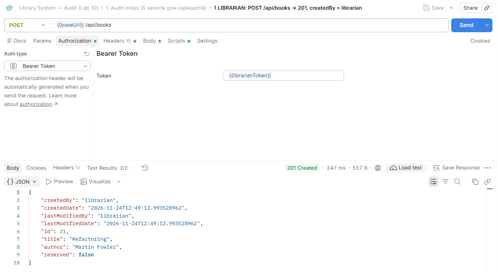
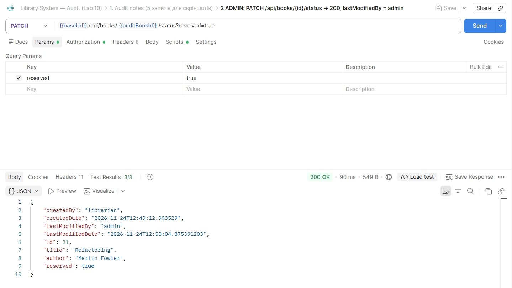
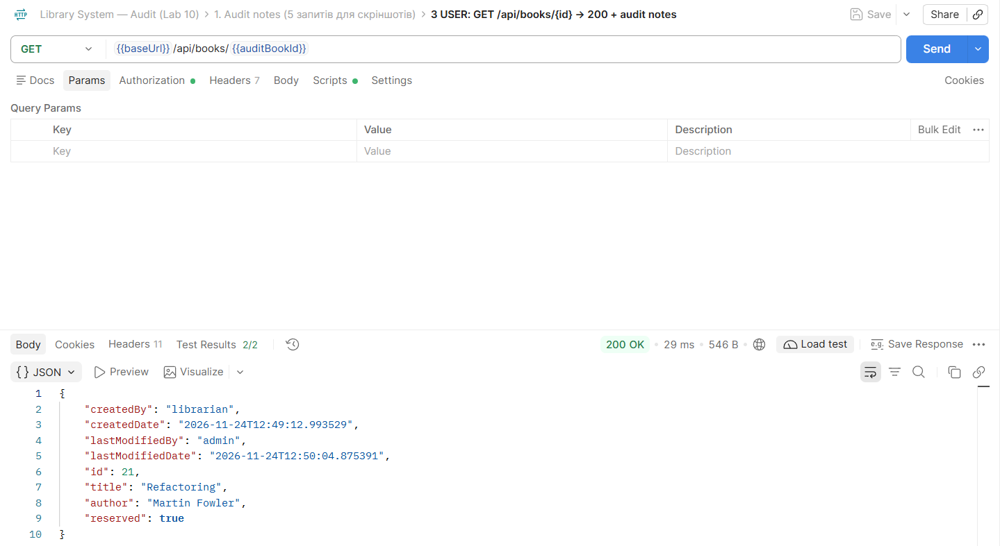
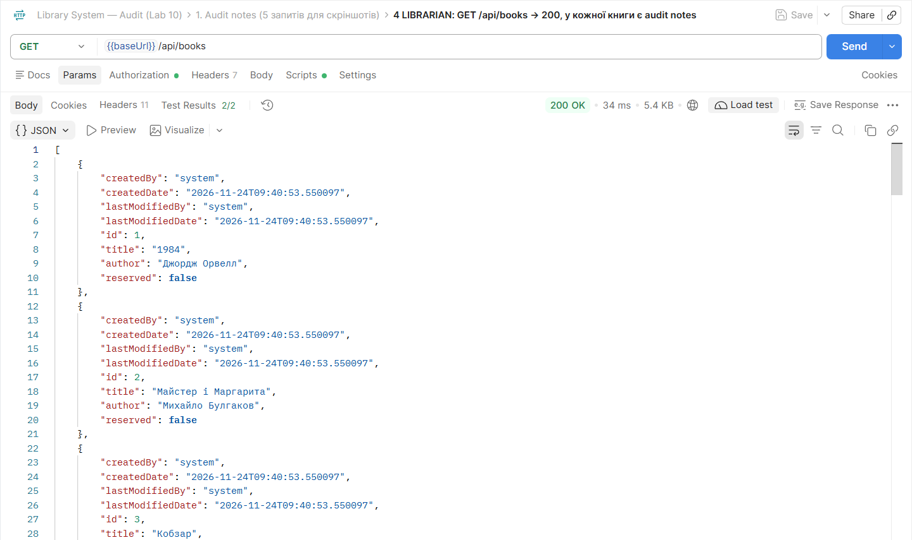
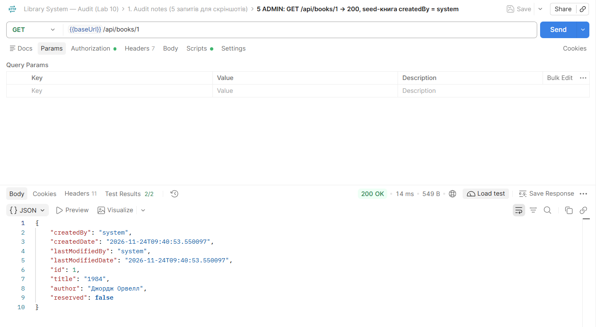

# Lab 10 — Audit notes (JPA Auditing) + JWT

Окрема колекція: [`postman/Library-Audit.postman_collection.json`](postman/Library-Audit.postman_collection.json)
(Postman → **Import** → вибрати файл → **Run collection**). Ті самі запити є й у загальній колекції, папка **5. Audit (Lab 10)**.

## Як працює

- Книга (`Book`) наслідує `Auditable` → має поля `createdBy`, `createdDate`, `lastModifiedBy`, `lastModifiedDate`.
- `JpaAuditingConfig` бере username з JWT-токена (SecurityContext) і автоматично записує його в ці поля.
- Seed-книги (міграція `V8`) позначені як створені `system`.

## Порядок запуску

1. `docker compose up -d --build`
2. Import `Library-Audit.postman_collection.json` → **Run collection** (або вручну по черзі:
   3 логіни, потім запити 1 → 5).

## Скріншоти

### 1. LIBRARIAN: POST /api/books → 201, `createdBy = librarian`

### 2. ADMIN: PATCH /api/books/{id}/status → 200, `lastModifiedBy = admin`

### 3. USER: GET /api/books/{id} → 200, видно хто створив і хто змінив

### 4. LIBRARIAN: GET /api/books → 200, у всіх книг є audit notes

### 5. ADMIN: GET /api/books/1 → 200, seed-книга `createdBy = system`

