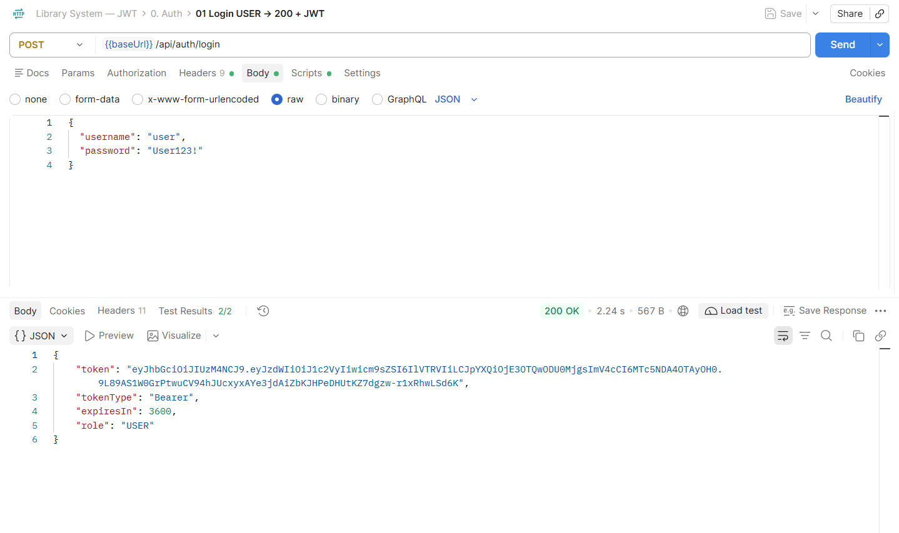
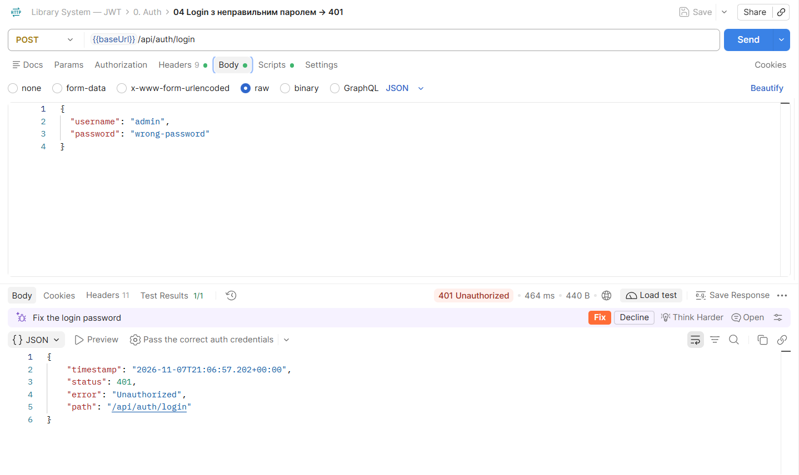
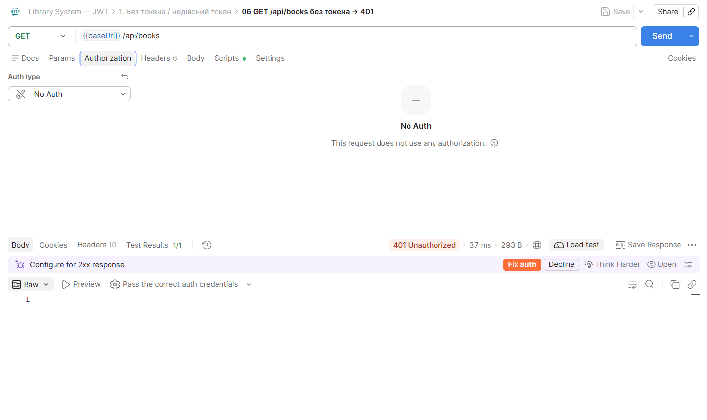
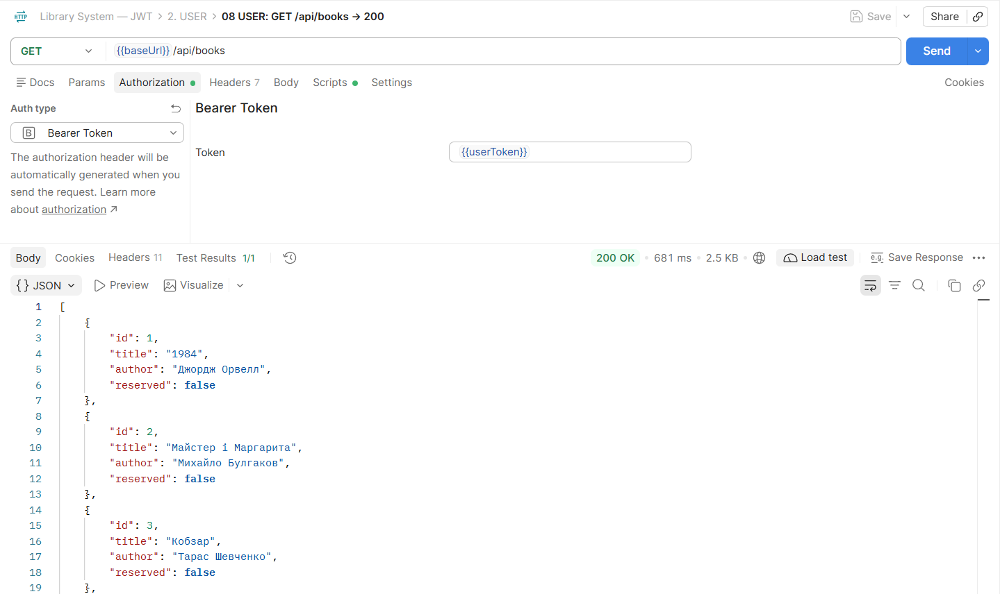
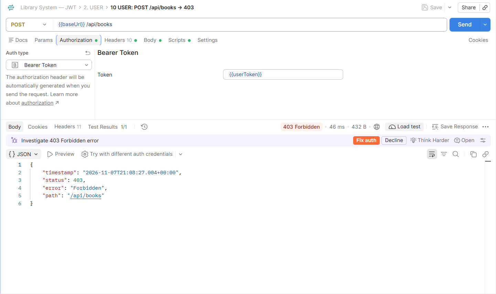
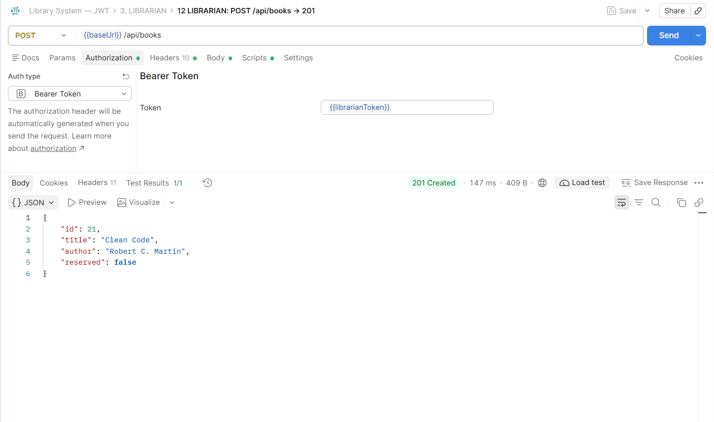
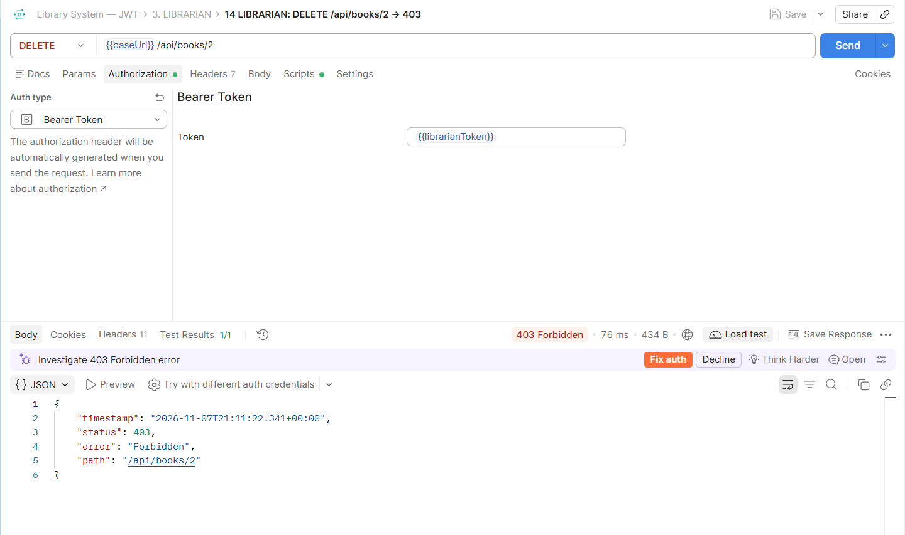
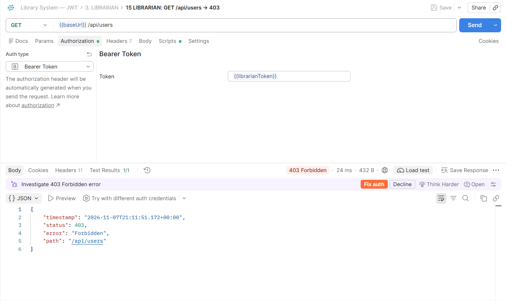
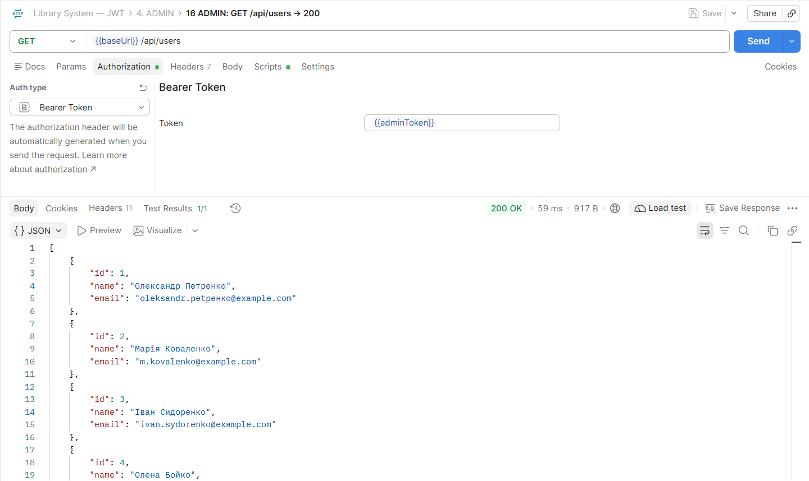
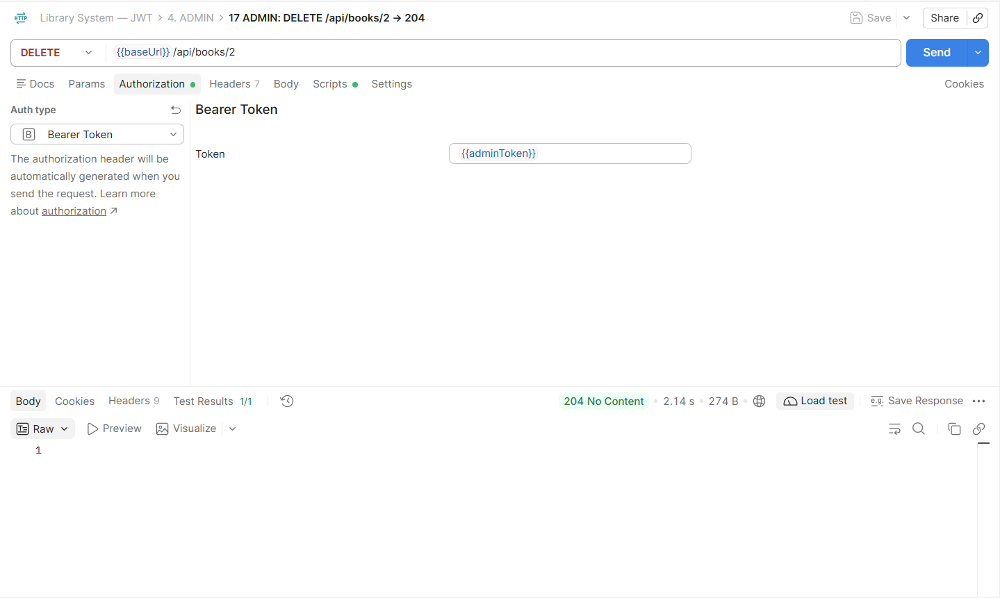

# Lab 8 — JWT авторизація: перевірка доступу в Postman

Колекція: [`postman/Library-JWT.postman_collection.json`](postman/Library-JWT.postman_collection.json)
(Postman → **Import**; Talend API Tester → **Import → Postman collection**).

## Як працює

1. `POST /api/auth/login` з `{ "username", "password" }` → сервер перевіряє користувача в таблиці `accounts`
   (пароль — BCrypt-хеш) і повертає JWT (HS256, 60 хв) з claim `role`.
2. Подальші запити — із заголовком `Authorization: Bearer <token>`.
3. Без токена / з недійсним токеном → **401**, з токеном без потрібної ролі → **403**.

| Логін       | Пароль          | Роль      | Доступ                                                       |
|-------------|-----------------|-----------|--------------------------------------------------------------|
| `user`      | `User123!`      | USER      | перегляд книг, створення бронювання                          |
| `librarian` | `Librarian123!` | LIBRARIAN | USER + додавання книг, статус, керування бронюваннями         |
| `admin`     | `Adminamdin123!`| ADMIN     | повний доступ (видалення книг, керування користувачами)      |

## Скріншоти

### 1. Логін ADMIN → 200, отримано JWT

### 2. Логін з неправильним паролем → 401

### 3. GET /api/books без токена → 401

### 4. USER: GET /api/books → 200

### 5. USER: POST /api/books → 403

### 6. LIBRARIAN: POST /api/books → 201

### 7. LIBRARIAN: DELETE /api/books/2 → 403

### 8. LIBRARIAN: GET /api/users → 403

### 9. ADMIN: GET /api/users → 200

### 10. ADMIN: DELETE /api/books/2 → 204

